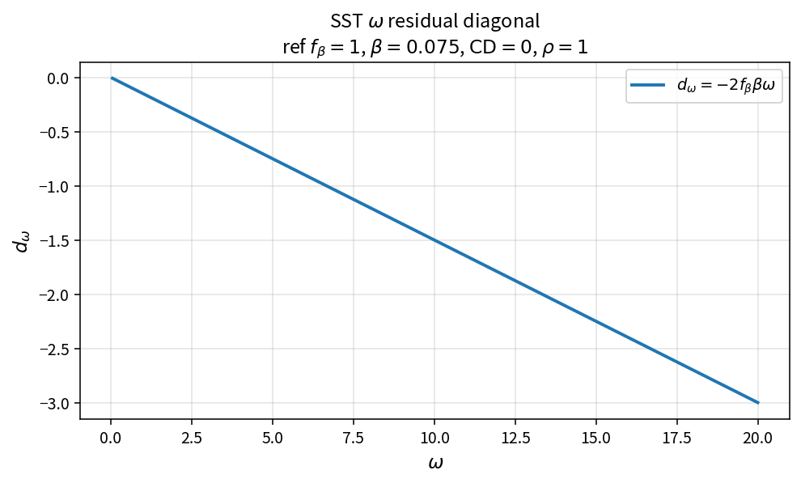

SST omega residual diagonal
===========================

Purpose
-------

Evaluate the linearized diagonal contribution of the \(\omega\) equation.

Formula
-------

.. math::

   d_\omega
   =
   -2\,f_\beta\,\beta\,\omega
   -
   \frac{|\mathrm{CD}|}{\rho\,\omega}

Source map
----------

* ``SstDiagonalW`` in ``TurbSstPolicy``
* Tests: ``tests/solver/turb_sst_residual_test.cpp``
* Theory table: ``tools/verification/data/sst_diagonal_w_theory.csv``
* Contract Workbench id: ``sst_diagonal_w``

What this proves / does not prove
---------------------------------

**Proves:** diagonal algebra matches the pure API (with and without CD).

**Does not prove:** full residual Jacobian or case convergence.

References
----------

* Menter SST linearization; NASA TMR SST.
* Related: :doc:`sst_diagonal_k`, ``sst_residual_diagonal``.
