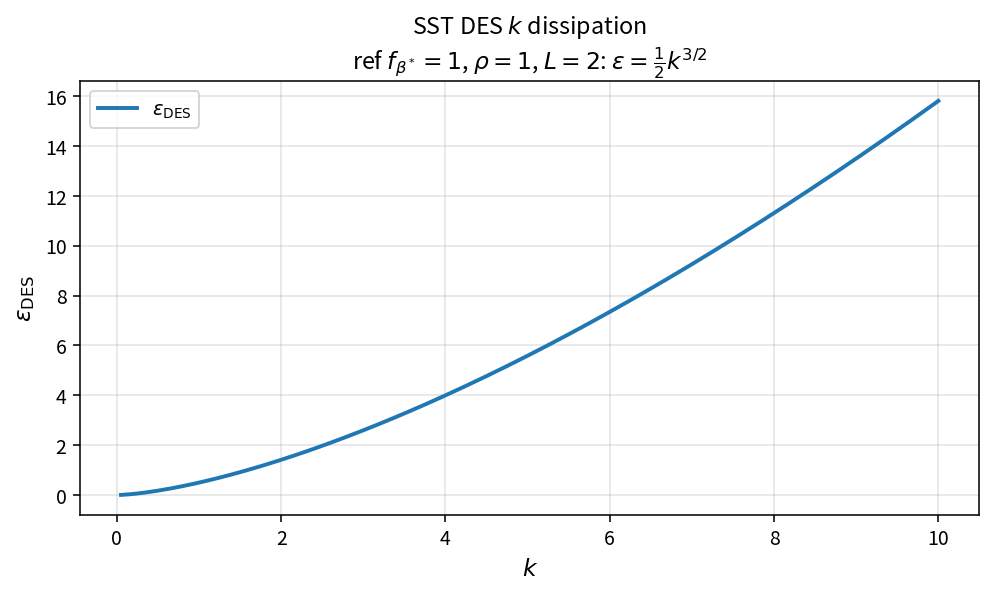

SST DES k dissipation
=====================

Purpose
-------

Evaluate the DES-style turbulent kinetic energy dissipation that replaces the
standard \(\omega\)-based destruction with a length-scale form.

Formula
-------

.. math::

   \varepsilon_{\mathrm{DES}}
   =
   f_{\beta^*}\,\rho\,k^{3/2}/L

Source map
----------

* ``SstDisskDes`` in ``TurbSstPolicy``
* Alternate: ``SstDisskStandard``
* Downstream: ``SstLimitProdk``, ``SstSourceK``
* Tests: ``tests/solver/turb_sst_policy_test.cpp``
* Theory table: ``tools/verification/data/sst_dissk_des_theory.csv``
* Contract Workbench id: ``sst_dissk_des``

What this proves / does not prove
---------------------------------

**Proves:** DES dissipation algebra matches the pure API on a \(k\) grid.

**Does not prove:** full DES residual field or how \(L\) is constructed.

References
----------

* Spalart DES; Menter SST-DES variants; NASA TMR.
* Related: :doc:`sst_dissk_standard`.
