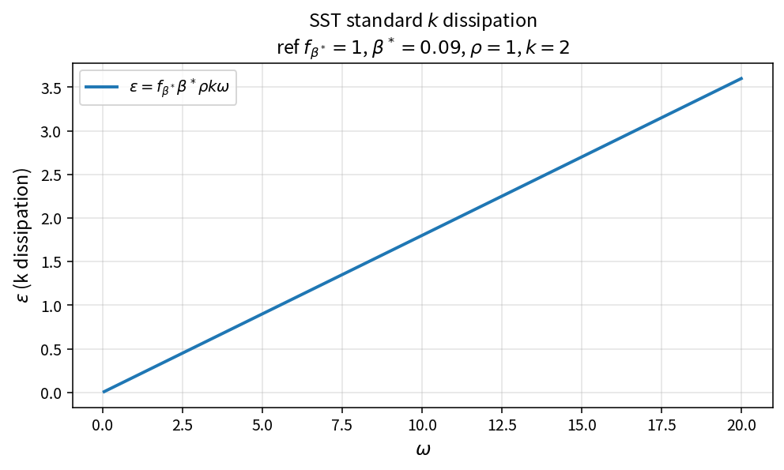

SST standard k dissipation
==========================

Purpose
-------

Evaluate the standard turbulent kinetic energy dissipation used in SST /
\(k\)-\(\omega\) source terms.

Formula
-------

.. math::

   \varepsilon = f_{\beta^*}\,\beta^*\,\rho\,k\,\omega

Source map
----------

* ``SstDisskStandard`` in ``TurbSstPolicy``
* Downstream: ``SstLimitProdk``, ``SstSourceK``
* Tests: ``tests/solver/turb_sst_policy_test.cpp``
* Theory table: ``tools/verification/data/sst_dissk_standard_theory.csv``
* Contract Workbench id: ``sst_dissk_standard``

What this proves / does not prove
---------------------------------

**Proves:** dissipation algebra matches the pure API on an \(\omega\) grid.

**Does not prove:** full SST residual field or DES length-scale branch.

References
----------

* Menter SST; Wilcox \(k\)-\(\omega\); NASA TMR SST pages.
* Related catalog: ``sst_k_source``, production limiters.
