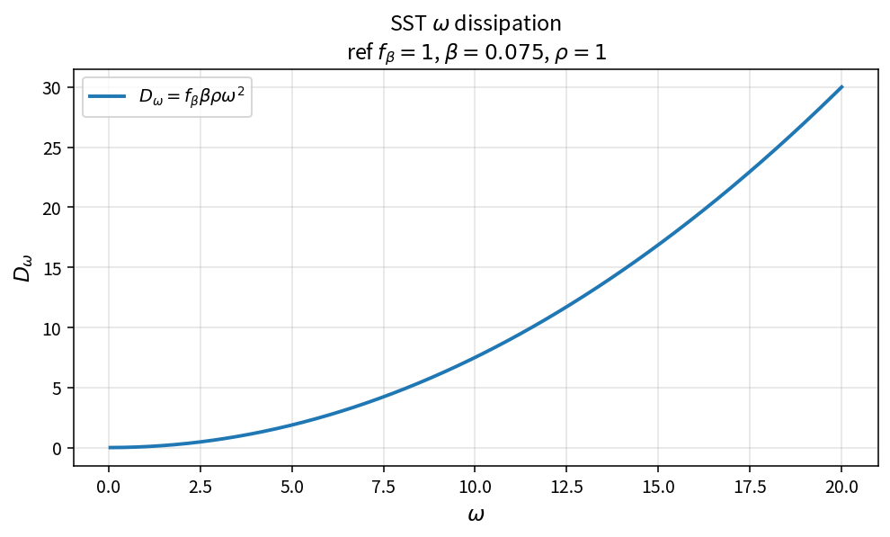

SST omega dissipation
=====================

Purpose
-------

Evaluate the specific-dissipation destruction term in the SST / \(k\)-\(\omega\)
omega equation.

Formula
-------

.. math::

   D_\omega = f_\beta\,\beta\,\rho\,\omega^{2}

Source map
----------

* ``SstDissw`` in ``TurbSstPolicy``
* Downstream: ``SstSourceW``
* Tests: ``tests/solver/turb_sst_policy_test.cpp``
* Theory table: ``tools/verification/data/sst_dissw_theory.csv``
* Contract Workbench id: ``sst_dissw``

What this proves / does not prove
---------------------------------

**Proves:** \(D_\omega\) algebra matches the pure API on an \(\omega\) grid.

**Does not prove:** full SST residual field or production/cross-diffusion terms.

References
----------

* Menter SST; Wilcox \(k\)-\(\omega\); NASA TMR SST.
* Related catalog: ``sst_omega_source``.
