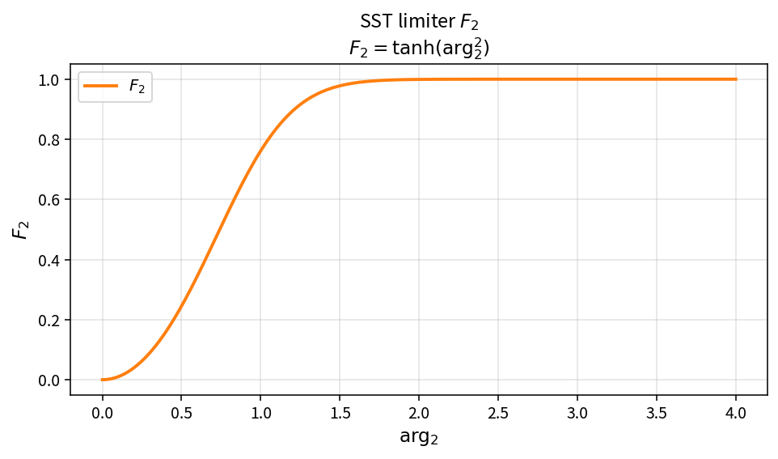

SST eddy viscosity and F2
=========================

.. math::

   \mathrm{arg}_2
   = \max\Big(
   \frac{2\sqrt{k}}{\beta^* d\omega},\,
   \frac{500\nu}{\omega d^2 Re}
   \Big),
   \qquad
   F_2 = \tanh(\mathrm{arg}_2^2)

.. math::

   \mu_t
   = \frac{\rho k}
   {\max(\omega,\,R F_2/a_1)}\,Re

Here :math:`R` is the rate magnitude selected by the SST production option:
the strain-rate magnitude when ``iprod_sst == 1``, otherwise the
vorticity magnitude. For velocity gradient :math:`\nabla\mathbf{u}`, the
strain invariant is :math:`|S|=\sqrt{2 S_{ij}S_{ij}}`, with
:math:`S_{ij}=\tfrac12(\partial_j u_i+\partial_i u_j)`. The alternative
vorticity magnitude is :math:`|\Omega|=|\nabla\times\mathbf{u}|`. Both are computed by separately tested pure policy functions. The option
selection is also isolated: exactly ``iprod_sst == 1`` selects strain rate;
all other integer values select vorticity. The selected quantity is passed
unchanged to the Bradshaw limiter. The solver applies an
optional laminar-viscosity
ratio cap after this expression, implemented by the shared
``TurbCappedEddyViscosity()`` policy used by both SA and SST.

Intermediate checks cover both denominator branches: the :math:`\omega`
limit when :math:`R F_2/a_1 \leq \omega`, and the strain/vorticity
limit when :math:`R F_2/a_1 > \omega`. The curve test also checks
:math:`F_2(0)=0` and :math:`F_2\to 1` for large arg.

References
----------

* Menter SST; NASA TMR SST.
* See ``sa_eddy_viscosity.rst`` and ``verification_layers.rst``.

Pure APIs: ``SstStrainRateMagnitude``, ``SstVorticityMagnitude``,
``SstLimitingRateMagnitude``, ``SstF2Argument``,
``SstF2ArgFromTerms``, ``SstF2FromArg``, ``SstEddyViscosity``.

Intermediate verification
-------------------------

The production path now obtains :math:`\mathrm{arg}_2` through
``SstF2Argument(k, omega, d, betaStar, mu, rho, Re)``. This evaluates both
the length-scale term and the viscous term before applying their maximum.
Focused tests activate each term in turn, so the complete primitive-input
formula is checked rather than only the final maximum of two supplied values.

The per-cell closure is now composed by ``SstComputeEddyViscosity(input)``.
Its input record names the physical state and all nine velocity-gradient
components; its result record exposes :math:`\mathrm{arg}_2`, :math:`F_2`,
the selected rate magnitude, the uncapped :math:`\mu_t`, and the final
laminar-ratio-capped value. ``TurbSrcFlux::CalcCellVist2Equ`` only maps the
solver cell state into this input and writes the returned viscosity. Thus
unit tests exercise the same ordered closure used by the production path,
including production-option selection and the shared SA/SST cap policy.

This is a complete *cell closure* contract, not yet a mesh-level regression:
the finite-volume loop, gradient reconstruction, wall-distance field,
boundary ghost-cell copy, and converged flow solution remain covered by
separate integration and CFD regression layers.

Closed-form checks of :math:`F_2(\mathrm{arg}_2)=\tanh(\mathrm{arg}_2^2)`
live in ``turb_sst_eddy_viscosity_test`` and theory table
``tools/verification/data/sst_f2_arg2_theory.csv`` (Contract Workbench Plot).

The rate invariants also have a coordinate-frame contract: under an orthogonal
basis change Q, the gradient transforms as G' = Q^T G Q; both |S| and |Omega|
must remain unchanged. The focused tests check this invariance on a nontrivial
gradient tensor and separately verify that rigid-body rotation has zero strain
but nonzero vorticity. These checks protect the tensor interpretation, not only
individual component arithmetic.

Production data flow
--------------------

The production update is a cell-field operation, not a call with an
already-populated viscosity. ``UTurbSrcFlux::CalcVist`` initializes the
unstructured-grid and turbulence-field views, refreshes mean-flow gradients,
then calls ``CalcVist2Equ`` for the two-equation models. For each interior
cell, ``CalcVist2Equ`` reads the nine mean-velocity gradient components,
density, :math:`k`, :math:`\\omega`, laminar viscosity, and wall distance
from their corresponding fields. ``TurbSrcFlux::CalcCellVist2Equ`` adds the
case-level SST constants and options initialized by ``TurbCom::Init``
(:math:`Re`, :math:`\\beta^*`, :math:`a_1`, ``iprod_sst``, and the maximum
viscosity ratio), evaluates ``SstComputeEddyViscosity``, and writes the
result back to the cell's eddy-viscosity field.

The previous eddy-viscosity field value is not an input to this closure. The
cell update therefore no longer reads it before computing the replacement.
After all interior cells are updated, ``SetGhostCellVist`` copies the
adjacent interior value to boundary ghost cells, and ``CalcVistMax`` scans
the resulting field. This separates three contracts that should be verified
independently: per-cell closure, field traversal/write-back, and ghost-cell
synchronization.

The remaining integration gap is a mesh-backed test of that complete field
path. The current pure policy tests validate the numerical closure; they do
not by themselves prove that gradient and primitive fields are indexed
correctly for every cell or that ghost values are synchronized as intended.
