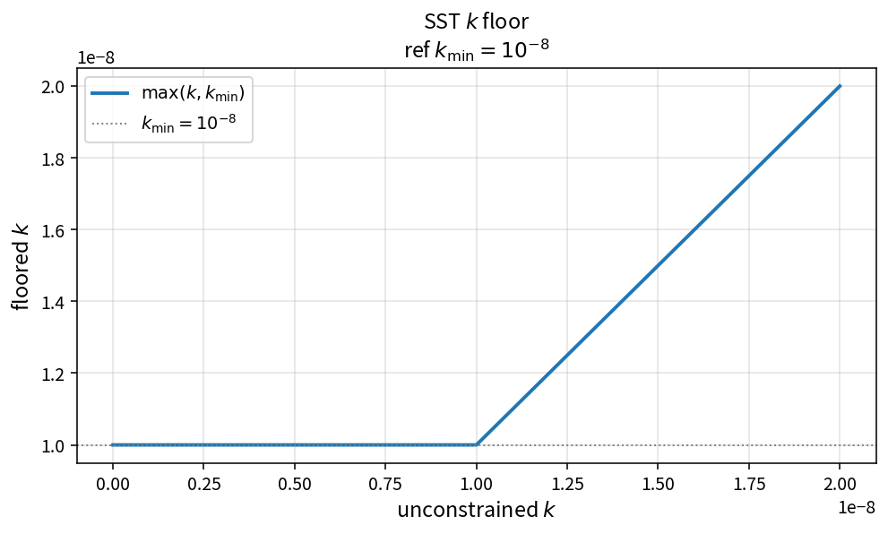

SST k floor
===========

Purpose
-------

Enforce a positive lower bound on turbulent kinetic energy after the update.

Formula
-------

.. math::

   k \leftarrow \max(k,k_{\min})

Source map
----------

* ``SstFloorKineticEnergy`` in ``TurbSstPolicy``
* Related: ``SstFloorOmega``, ``SstDensityScaledUpdate``
* Tests: ``tests/solver/turb_sst_update_floor_test.cpp``
* Theory table: ``tools/verification/data/sst_floor_kinetic_energy_theory.csv``
* Contract Workbench id: ``sst_floor_kinetic_energy``

What this proves / does not prove
---------------------------------

**Proves:** \(k\)-floor algebra matches the pure API on a \(k\) grid.

**Does not prove:** optimal \(k_{\min}\) or case stability margins.

References
----------

* SST solver robustness practice; NASA TMR SST.
* Related: :doc:`sst_floor_omega`, :doc:`sst_density_scaled_update`.
