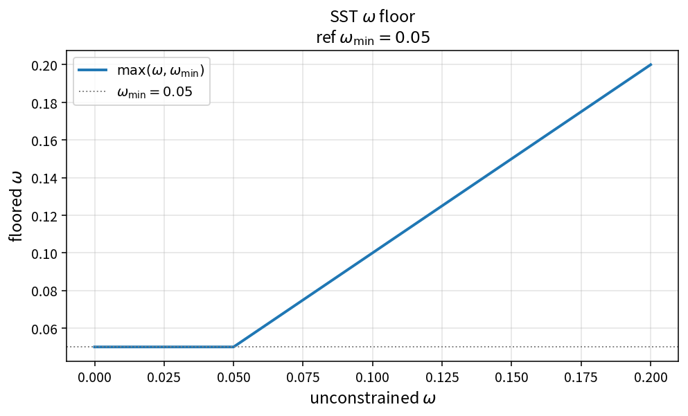

SST omega floor
===============

Purpose
-------

Enforce a positive lower bound on the specific dissipation rate.

Formula
-------

.. math::

   \omega \leftarrow \max(\omega,\omega_{\min})

Source map
----------

* ``SstFloorOmega`` in ``TurbSstPolicy``
* Related: ``SstFloorKineticEnergy``
* Tests: ``tests/solver/turb_sst_update_floor_test.cpp``
* Theory table: ``tools/verification/data/sst_floor_omega_theory.csv``
* Contract Workbench id: ``sst_floor_omega``

What this proves / does not prove
---------------------------------

**Proves:** floor algebra matches the pure API on an \(\omega\) grid.

**Does not prove:** optimal \(\omega_{\min}\) or case stability margins.

References
----------

* SST solver robustness practice; NASA TMR SST.
* Related positivity floors for \(k\).
