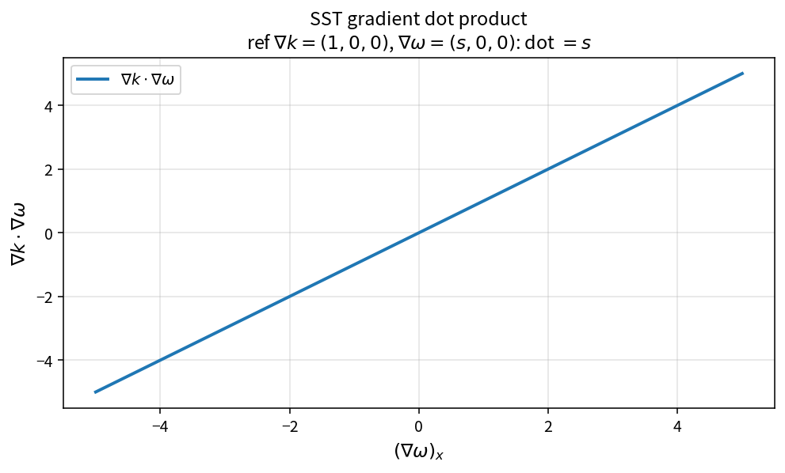

SST gradient dot product
========================

Purpose
-------

Evaluate \(\nabla k\cdot\nabla\omega\) for cross-diffusion constructions.

Formula
-------

.. math::

   \nabla k\cdot\nabla\omega
   =
   (\partial_i k)(\partial_i\omega)

Source map
----------

* ``SstGradientDotProduct`` in ``TurbSstPolicy``
* Downstream: ``SstCrossDiffScalar``, ``SstCrossDiffMenter``,
  ``WilcoxXkFromCrossTerm``
* Tests: ``tests/solver/turb_sst_policy_test.cpp``
* Theory table: ``tools/verification/data/sst_gradient_dot_product_theory.csv``
* Contract Workbench id: ``sst_gradient_dot_product``

What this proves / does not prove
---------------------------------

**Proves:** dot-product algebra matches the pure API.

**Does not prove:** gradient reconstruction accuracy on a case mesh.

References
----------

* Menter SST cross-diffusion; NASA TMR SST.
* Related: :doc:`sst_cross_diff_scalar`.
