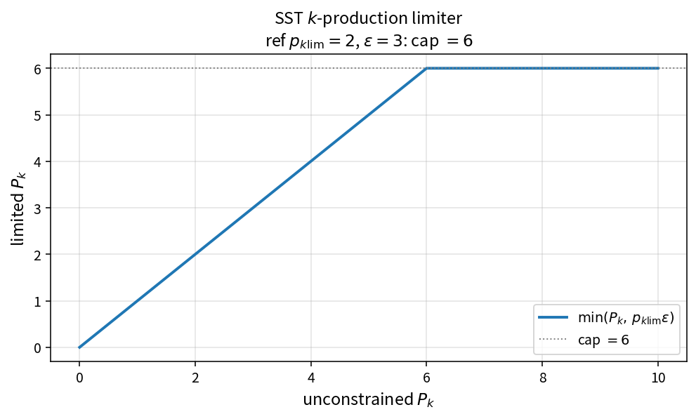

SST k-production limiter
========================

Purpose
-------

Cap turbulent kinetic energy production relative to dissipation.

Formula
-------

.. math::

   P_k \leftarrow \min(P_k,\,p_{k\lim}\,\varepsilon)

Source map
----------

* ``SstLimitProdk`` in ``TurbSstPolicy``
* Upstream dissipation: ``SstDisskStandard``
* Downstream: ``SstSourceK``
* Tests: ``tests/solver/turb_sst_policy_test.cpp``
* Theory table: ``tools/verification/data/sst_limit_prodk_theory.csv``
* Contract Workbench id: ``sst_limit_prodk``

What this proves / does not prove
---------------------------------

**Proves:** \(\min(P_k,p_{k\lim}\varepsilon)\) matches the pure API.

**Does not prove:** case-optimal \(p_{k\lim}\) or full SST residual.

References
----------

* Menter SST production limiter practice; NASA TMR SST.
* Related: :doc:`sst_dissk_standard`.
