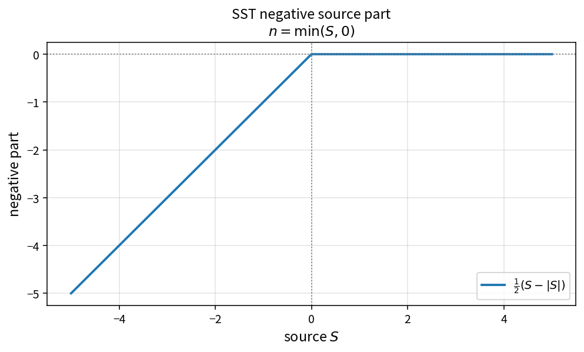

SST negative source part
========================

Purpose
-------

Extract the non-positive part of a turbulence source residual for implicit
linearization.

Formula
-------

.. math::

   n = \min(S,0)

Source map
----------

* ``SstNegativeSourcePart`` in ``TurbSstPolicy``
* Upstream residual: ``SstSourceK``, ``SstSourceW``
* Tests: ``tests/solver/turb_sst_residual_test.cpp``
* Theory table: ``tools/verification/data/sst_negative_source_part_theory.csv``
* Contract Workbench id: ``sst_negative_source_part``

What this proves / does not prove
---------------------------------

**Proves:** negative-part algebra matches the pure API.

**Does not prove:** full residual Jacobian or case convergence.

References
----------

* Menter SST linearization practice.
* Related residual diagonal and source assembly entries.
