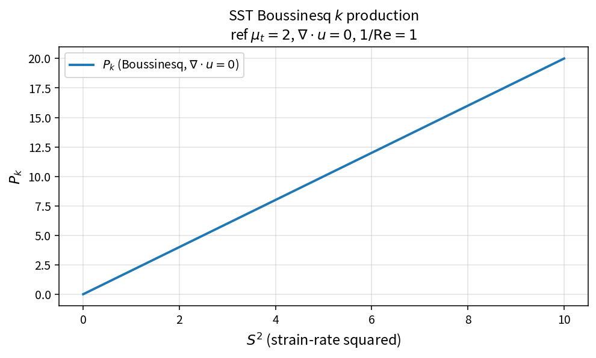

SST Boussinesq k production
===========================

Purpose
-------

Evaluate turbulent kinetic energy production from the Boussinesq eddy-viscosity
hypothesis, including divergence corrections.

Formula
-------

.. math::

   P_k
   =
   \mu_t\bigl(S^{2}-\tfrac23(\nabla\cdot\mathbf{u})^{2}\bigr)/\mathrm{Re}
   -
   \tfrac23\rho k(\nabla\cdot\mathbf{u})

At zero divergence this reduces to \(P_k=\mu_t S^{2}/\mathrm{Re}\).

Source map
----------

* ``SstProdkBoussinesq`` in ``TurbSstPolicy``
* Alternatives: ``SstProdkStrainOnly``, ``SstProdkVorticity``
* Downstream: ``SstLimitProdk``, ``SstSourceK``
* Tests: ``tests/solver/turb_sst_policy_test.cpp``
* Theory table: ``tools/verification/data/sst_prodk_boussinesq_theory.csv``
* Contract Workbench id: ``sst_prodk_boussinesq``

What this proves / does not prove
---------------------------------

**Proves:** production algebra matches the pure API (including a divergence sample).

**Does not prove:** full residual field or production-limiter interaction on a case.

References
----------

* Menter SST; standard Boussinesq production forms.
* Related: :doc:`sst_limit_prodk`, :doc:`sst_dissk_standard`.
