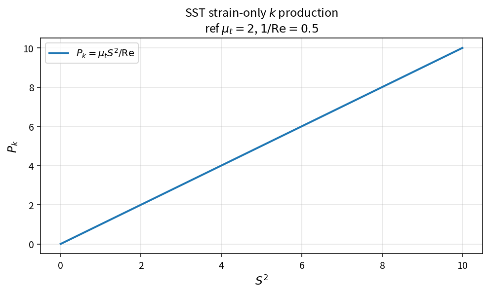

SST strain-only k production
============================

Purpose
-------

Evaluate a simplified turbulent kinetic energy production based only on
strain-rate magnitude.

Formula
-------

.. math::

   P_k = \mu_t S^{2}/\mathrm{Re}

Source map
----------

* ``SstProdkStrainOnly`` in ``TurbSstPolicy``
* Alternatives: ``SstProdkBoussinesq``, ``SstProdkVorticity``
* Downstream: ``SstLimitProdk``
* Tests: ``tests/solver/turb_sst_policy_test.cpp``
* Theory table: ``tools/verification/data/sst_prodk_strain_only_theory.csv``
* Contract Workbench id: ``sst_prodk_strain_only``

What this proves / does not prove
---------------------------------

**Proves:** strain-only production algebra matches the pure API.

**Does not prove:** superiority of this option over Boussinesq/vorticity forms.

References
----------

* SST production-option practice; NASA TMR SST.
* Related: :doc:`sst_prodk_boussinesq`.
