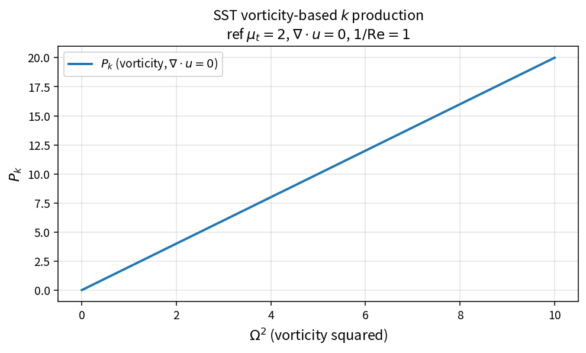

SST vorticity-based k production
================================

Purpose
-------

Evaluate turbulent kinetic energy production from vorticity magnitude, with
divergence correction.

Formula
-------

.. math::

   P_k
   =
   \mu_t\Omega^{2}/\mathrm{Re}
   -
   \tfrac23\rho k(\nabla\cdot\mathbf{u})

At zero divergence: \(P_k=\mu_t\Omega^{2}/\mathrm{Re}\).

Source map
----------

* ``SstProdkVorticity`` in ``TurbSstPolicy``
* Alternatives: ``SstProdkBoussinesq``, ``SstProdkStrainOnly``
* Downstream: ``SstLimitProdk``
* Tests: ``tests/solver/turb_sst_policy_test.cpp``
* Theory table: ``tools/verification/data/sst_prodk_vorticity_theory.csv``
* Contract Workbench id: ``sst_prodk_vorticity``

What this proves / does not prove
---------------------------------

**Proves:** vorticity production algebra matches the pure API.

**Does not prove:** superiority of this option over strain/Boussinesq forms.

References
----------

* SST production-option practice; NASA TMR SST.
* Related: :doc:`sst_prodk_boussinesq`, :doc:`sst_prodk_strain_only`.
