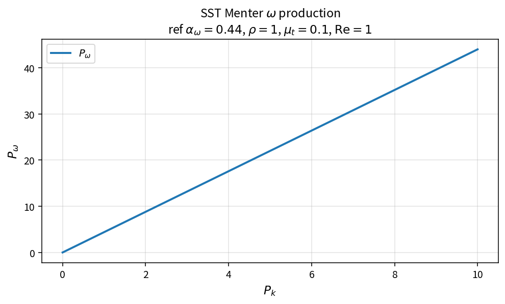

SST Menter omega production
===========================

Purpose
-------

Convert limited turbulent kinetic energy production into the specific
dissipation production term used by the Menter SST omega equation.

Formula
-------

.. math::

   P_\omega
   =
   \alpha_\omega\frac{\rho}{\mu_t}P_k\,\mathrm{Re}

Source map
----------

* ``SstProdwMenter`` in ``TurbSstPolicy``
* Downstream: ``SstSourceW``
* Alternate branch: ``SstProdwWilcox``
* Tests: ``tests/solver/turb_sst_policy_test.cpp``
* Theory table: ``tools/verification/data/sst_prodw_menter_theory.csv``
* Contract Workbench id: ``sst_prodw_menter``

What this proves / does not prove
---------------------------------

**Proves:** \(P_\omega\) algebra matches the pure API on a \(P_k\) grid.

**Does not prove:** full SST residual field or Wilcox production branch.

References
----------

* Menter, Zonal Two Equation \(k\)-\(\omega\) Turbulence Models (1994).
* NASA Turbulence Modeling Resource (SST).
* Related: :doc:`sst_dissw`, :doc:`sst_cross_diff_menter`.
