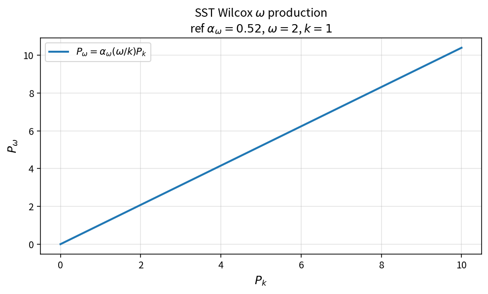

SST Wilcox omega production
===========================

Purpose
-------

Convert limited turbulent kinetic energy production into omega production
using the Wilcox \(\omega/k\) scaling.

Formula
-------

.. math::

   P_\omega = \alpha_\omega\frac{\omega}{k}P_k

Source map
----------

* ``SstProdwWilcox`` in ``TurbSstPolicy``
* Alternate: ``SstProdwMenter``
* Downstream: ``SstSourceW``
* Tests: ``tests/solver/turb_sst_policy_test.cpp``
* Theory table: ``tools/verification/data/sst_prodw_wilcox_theory.csv``
* Contract Workbench id: ``sst_prodw_wilcox``

What this proves / does not prove
---------------------------------

**Proves:** Wilcox \(P_\omega\) algebra matches the pure API on a \(P_k\) grid.

**Does not prove:** full residual field or equivalence to the Menter form.

References
----------

* Wilcox \(k\)-\(\omega\); Menter SST production options; NASA TMR SST.
* Related: :doc:`sst_prodw_menter`.
