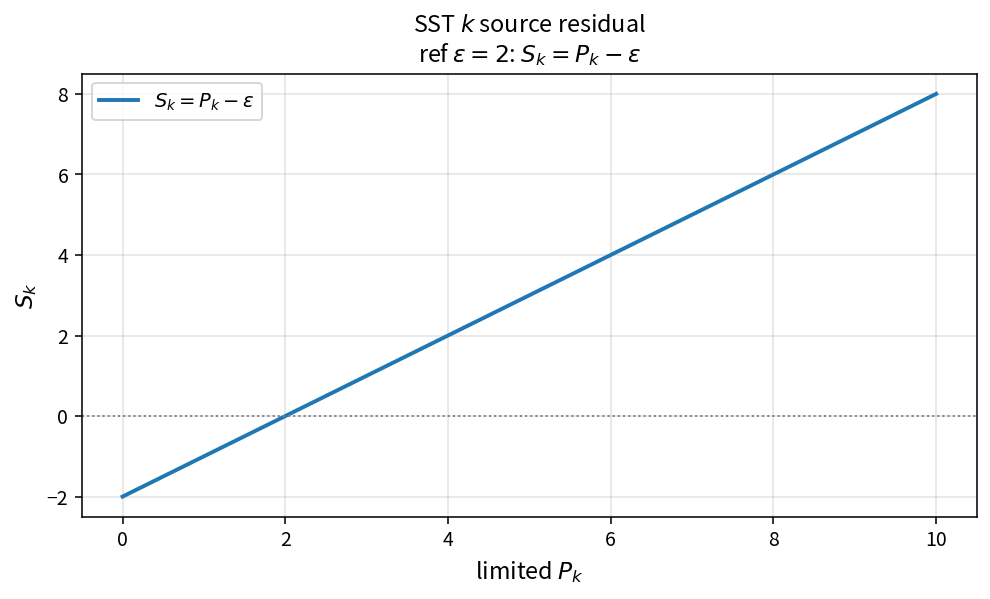

SST k source residual
=====================

Purpose
-------

Assemble the turbulent kinetic energy source residual from limited production
and dissipation.

Formula
-------

.. math::

   S_k = P_k - \varepsilon

with \(\varepsilon=f_{\beta^*}\beta^*\rho k\omega\) and
\(P_k\leftarrow\min(P_k,p_{k\lim}\varepsilon)\).

Source map
----------

* ``SstSourceK`` in ``TurbSstPolicy``
* Upstream: ``SstDisskStandard``, ``SstLimitProdk`` (and production options)
* Tests: ``tests/solver/turb_sst_residual_test.cpp``
* Theory table: ``tools/verification/data/sst_source_k_theory.csv``
* Contract Workbench id: ``sst_k_source``

What this proves / does not prove
---------------------------------

**Proves:** \(S_k=P_k-\varepsilon\) algebra and composition with dissipation/limiter.

**Does not prove:** full SST residual field or production-model choice accuracy.

References
----------

* Menter SST; NASA TMR SST.
* Related: :doc:`sst_dissk_standard`, :doc:`sst_limit_prodk`.
