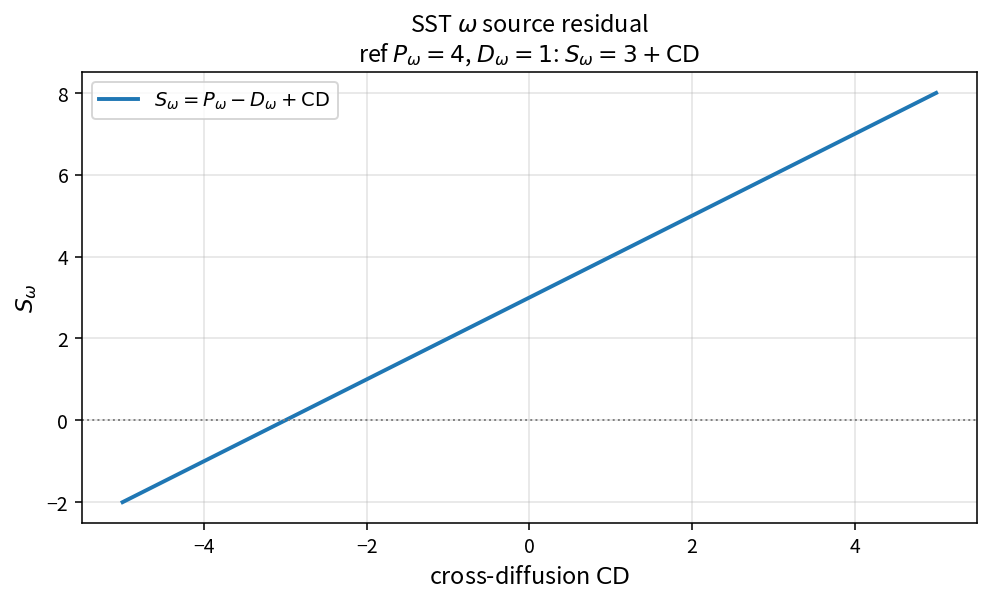

SST omega source residual
=========================

Purpose
-------

Assemble the specific-dissipation source residual from production, destruction
and cross-diffusion.

Formula
-------

.. math::

   S_\omega = P_\omega - D_\omega + \mathrm{CD}

with \(D_\omega=f_\beta\beta\rho\omega^{2}\).

Source map
----------

* ``SstSourceW`` in ``TurbSstPolicy``
* Upstream: ``SstDissw``, production and cross-diffusion pure APIs
* Tests: ``tests/solver/turb_sst_residual_test.cpp``
* Theory table: ``tools/verification/data/sst_source_w_theory.csv``
* Contract Workbench id: ``sst_omega_source``

What this proves / does not prove
---------------------------------

**Proves:** \(S_\omega\) assembly algebra and composition with ``SstDissw``.

**Does not prove:** full SST residual field or production-model choice accuracy.

References
----------

* Menter SST; NASA TMR SST.
* Related: :doc:`sst_dissw`.
