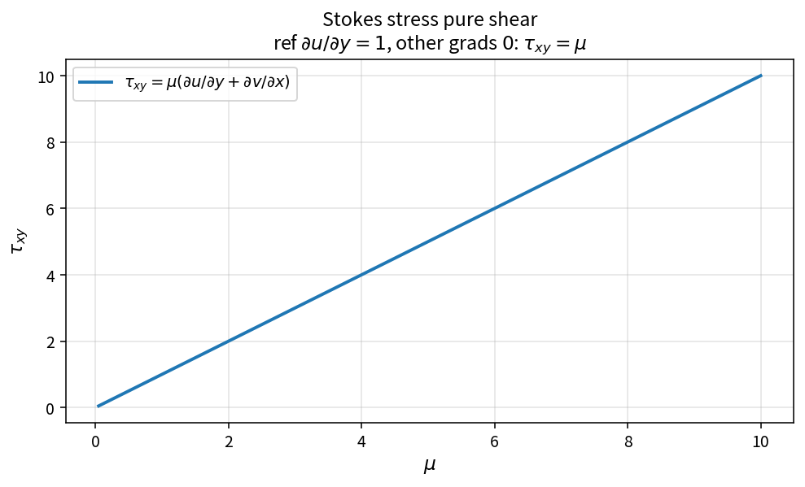

Stokes stress tensor
====================

Purpose
-------

The Newtonian Stokes stress supplies the viscous momentum fluxes. OneFLOW
isolates the constitutive evaluation as ``StokesStressTensor``.

Formula
-------

.. math::

   \tau_{ij}
   =\mu\left(
   \partial_i u_j+\partial_j u_i
   -\frac{2}{3}\delta_{ij}(\nabla\cdot\mathbf{u})
   \right)

**Pure shear** (\(\partial u/\partial y=1\), other gradients zero):

.. math::

   \tau_{xy}=\mu,\qquad \tau_{xx}=\tau_{yy}=\tau_{zz}=0

**Pure extension** (\(\partial u/\partial x=1\)):

.. math::

   \tau_{xx}=\mu\cdot\frac{4}{3},\qquad
   \tau_{yy}=\tau_{zz}=-\mu\cdot\frac{2}{3}

Source map
----------

* ``StokesStressTensor`` in ``NsVisFluxPolicy``
* Downstream: ``ProjectStressMomentumFlux``, ``ViscousEnergyFlux``
* Tests: ``tests/solver/vis_flux_policy_test.cpp``
* Theory table: ``tools/verification/data/stokes_stress_pure_shear_theory.csv``
* Contract Workbench id: ``stokes_stress_pure_shear``

What this proves / does not prove
---------------------------------

**Proves:** pure-shear and bulk-strain samples match the pure API.

**Does not prove:** full viscous face residual or turbulence eddy-viscosity
field construction.

References
----------

* Standard Newtonian / Stokes constitutive relation for compressible NS.
* Related: :doc:`effective_thermal_conductivity` for the energy heat flux.
