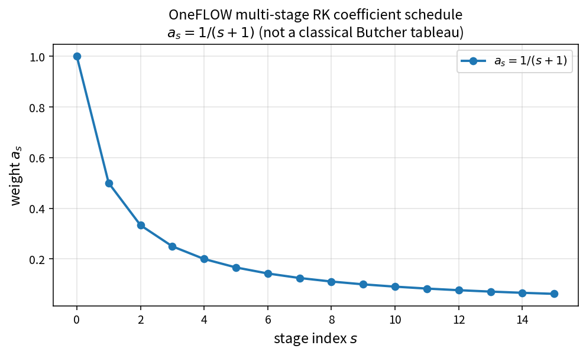

Runge-Kutta stage weight schedule
=================================

Purpose
-------

OneFLOW stores a multi-stage coefficient vector ``rk_coef`` with

.. math::

   a_s = \frac{1}{s+1},\qquad s = 0,\ldots,N-1

where \(N=\) ``rk_stage``. Each stage assigns ``ctrl.lhscoef = a_s`` before
residual/update tasks.

This is **OneFLOW's schedule**, not a claim of classical RK order or a
Butcher tableau.

Formula
-------

.. math::

   a_s = \frac{1}{s+1}

Source map
----------

* Pure API: ``RungeKuttaStageWeight`` in ``TimeIntegralPolicy.h``
* Consumers: ``Ctrl``, ``NsCtrl``, ``INsCtrl``, ``TurbCtrl`` fill ``rk_coef``
* Runtime: ``TimeIntegral::RungeKutta`` sets ``lhscoef``
* Tests: ``tests/solver/time_integral_policy_test.cpp``
* Theory table: ``tools/verification/data/time_integral_rk_stage_weight_theory.csv``
* Contract Workbench id: ``time_integral_rk_stage_weight``

What this proves / does not prove
---------------------------------

**Proves:** \(a_s=1/(s+1)`` matches the pure API and is what Ctrl builds.

**Does not prove:** temporal order, stability region, or dual-time accuracy.

References
----------

* OneFLOW ``TimeIntegral`` / control initialization (implementation fact).
* Classical RK literature for comparison only — coefficients differ.
