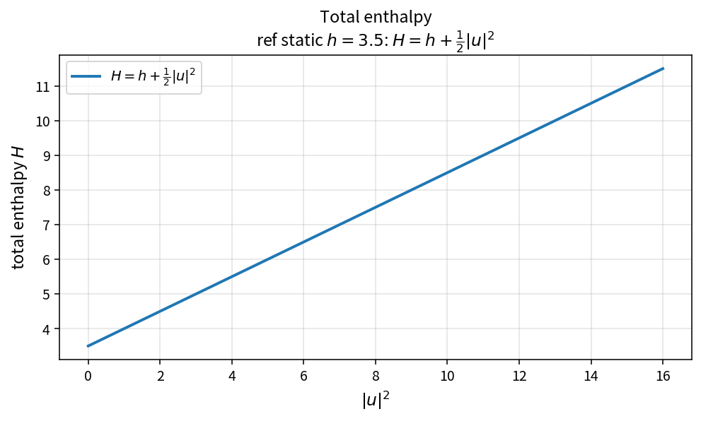

Total enthalpy
==============

Purpose
-------

Total enthalpy links static thermodynamics to the kinetic field and feeds
Roe averages, sound speed, and LUSGS face-pressure closures.

Formula
-------

.. math::

   H = h + \frac{1}{2}|u|^{2}

Source map
----------

* ``TotalEnthalpy`` in ``NsInvFluxPolicy``
* Upstream: ``IdealGasStaticEnthalpy``
* Downstream: ``IdealGasSoundSpeed``, ``RoePressureFromTotalEnthalpy``
* Tests: ``tests/solver/inv_flux_policy_test.cpp``
* Theory table: ``tools/verification/data/total_enthalpy_theory.csv``
* Contract Workbench id: ``total_enthalpy``

What this proves / does not prove
---------------------------------

**Proves:** \(H=h+|u|^{2}/2\) matches the pure API on a kinetic grid.

**Does not prove:** full Roe-averaged state or flux residual on a case.

References
----------

* Standard compressible-flow definition of total enthalpy.
* Related: :doc:`ideal_gas_static_enthalpy`, :doc:`ideal_gas_sound_speed`,
  :doc:`roe_pressure_from_enthalpy`.
