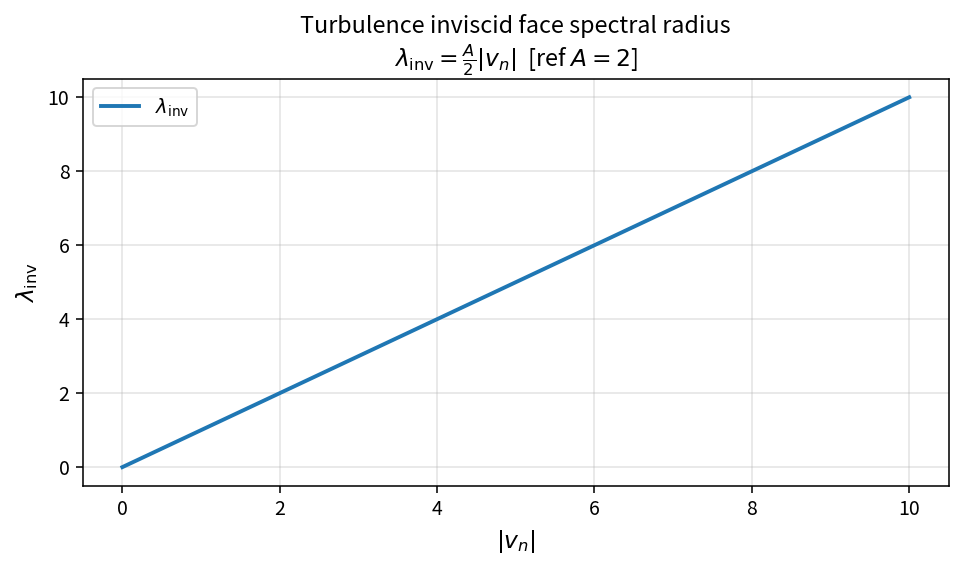
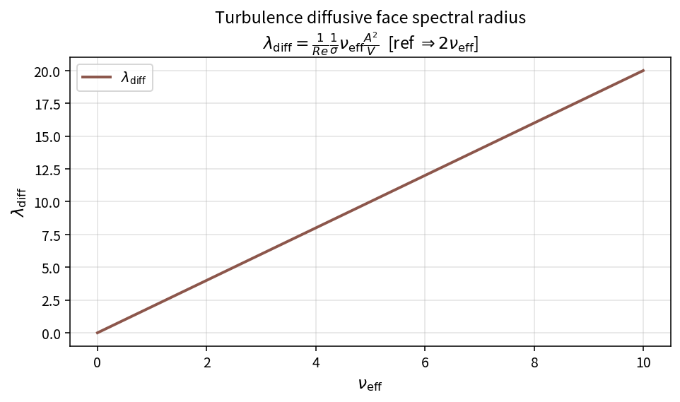

Turbulence face spectral radius
===============================

Inviscid contribution
---------------------

.. math::

   \lambda_{\mathrm{inv}} = \frac{A}{2}|v_n|

Pure API: ``TurbInviscidFaceSpectralRadius``. Intermediate table:
``tools/verification/data/turb_inviscid_spectrum_theory.csv`` (reference face area
:math:`A=2`).

Diffusive contribution (SA)
---------------------------

.. math::

   \nu_{\mathrm{et}} = \frac{\mu_l}{\rho}+\tilde\nu,\qquad
   \lambda_{\mathrm{diff}} = \frac{1}{Re}\frac{1}{\sigma}\nu_{\mathrm{et}}
   \frac{A^{2}}{V}

Locks: ``turb_spectrum_policy_test``. Contract Workbench entry
``turb_inviscid_spectrum``.

**Proves:** pure spectral-radius algebra. **Does not prove:** turb LUSGS case
convergence.

Diffusive intermediate curve
----------------------------

Reference geometry in the theory table uses fixed
:math:`1/Re=1`, :math:`1/\sigma=1`, :math:`A^2=4`, :math:`1/V=0.5`, so
:math:`\lambda_{\mathrm{diff}}=2\nu_{\mathrm{eff}}`.

CSV: ``tools/verification/data/turb_diffusive_spectrum_theory.csv``.

