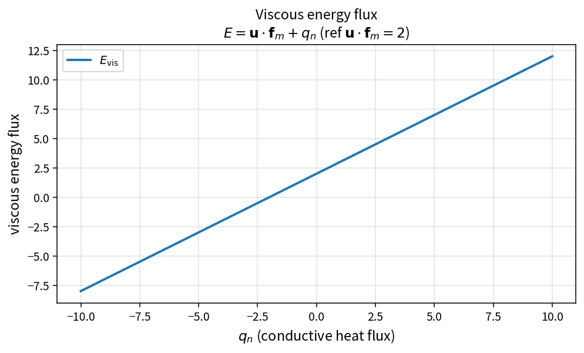

Viscous energy flux
===================

Purpose
-------

The viscous contribution to the energy face flux is the power of the
viscous stresses plus heat conduction.

Formula
-------

.. math::

   E_{\mathrm{vis}} = \mathbf{u}\cdot\mathbf{f}_m + q_n

where \(\mathbf{f}_m=\boldsymbol{\tau}\cdot\mathbf{n}\) and
\(q_n=k_{\mathrm{eff}}\,\partial_n T\).

Source map
----------

* ``ViscousEnergyFlux`` in ``NsVisFluxPolicy``
* Upstream: ``ProjectStressMomentumFlux``, ``ConductiveHeatFluxNormal``
* Tests: ``tests/solver/vis_flux_policy_test.cpp``
* Theory table: ``tools/verification/data/viscous_energy_flux_theory.csv``
* Contract Workbench id: ``viscous_energy_flux``

What this proves / does not prove
---------------------------------

**Proves:** energy-flux algebra matches the pure API on a sample grid.

**Does not prove:** full viscous residual or wall heat-transfer accuracy.

References
----------

* Compressible Navier–Stokes energy equation (viscous work + conduction).
* Related: :doc:`project_stress_momentum_flux`,
  :doc:`effective_thermal_conductivity`.
