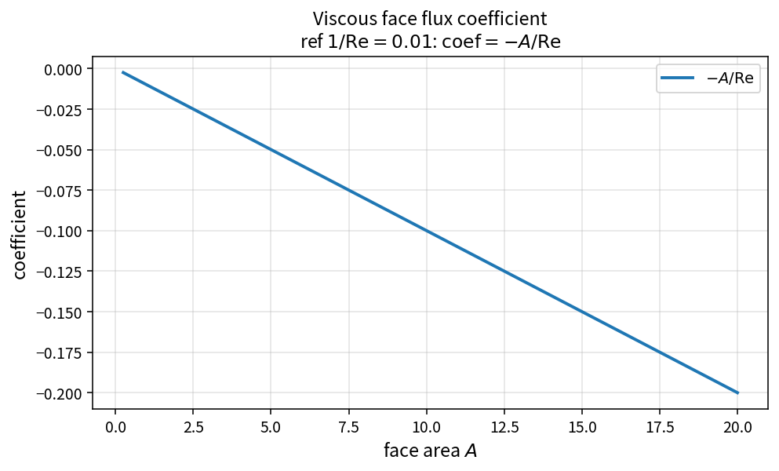

Viscous face flux coefficient
=============================

Purpose
-------

Scale viscous face contributions by area and inverse Reynolds number before
they enter the residual.

Formula
-------

.. math::

   \mathrm{coef} = -\frac{A}{\mathrm{Re}}

(OneFLOW passes ``invReynolds`` \(=1/\mathrm{Re}\) directly.)

Source map
----------

* ``ViscousFaceFluxCoefficient`` in ``NsVisFluxPolicy``
* Tests: ``tests/solver/vis_flux_policy_test.cpp``
* Theory table: ``tools/verification/data/viscous_face_flux_coefficient_theory.csv``
* Contract Workbench id: ``viscous_face_flux_coefficient``

What this proves / does not prove
---------------------------------

**Proves:** coefficient algebra matches the pure API.

**Does not prove:** full residual scaling on a production mesh.

References
----------

* Non-dimensional compressible Navier–Stokes viscous terms.
* Related viscous chain: Stokes stress, projection, heat flux, energy flux.
