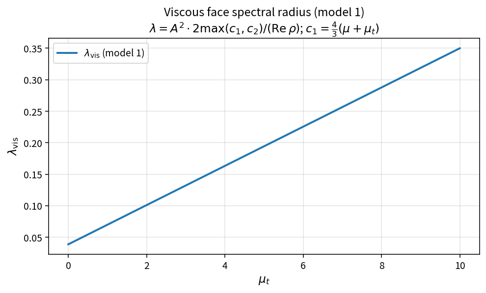

Viscous face spectral radius (model 1)
======================================

Purpose
-------

Model 1 estimates the viscous contribution to the local spectral radius for
time-step control, using the larger of momentum and energy diffusivities
(Blazek-style).

Formula
-------

.. math::

   c_1=\frac{4}{3}(\mu+\mu_t),\qquad
   c_2=\gamma\left(\frac{\mu}{\mathrm{Pr}_l}+\frac{\mu_t}{\mathrm{Pr}_t}\right)

   \lambda_{\mathrm{vis}}=A^{2}\cdot\frac{2\max(c_1,c_2)}{\mathrm{Re}\,\rho}

Source map
----------

* ``ViscousFaceSpectralRadiusModel1`` in ``TimeStepPolicy``
* Tests: ``tests/solver/timestep_policy_test.cpp``
* Theory table: ``tools/verification/data/viscous_spectral_radius_model1_theory.csv``
* Contract Workbench id: ``viscous_spectral_radius_model1``

What this proves / does not prove
---------------------------------

**Proves:** model-1 algebra matches the pure API on a sample grid.

**Does not prove:** models 2/3, or end-to-end CFL stability on a mesh.
