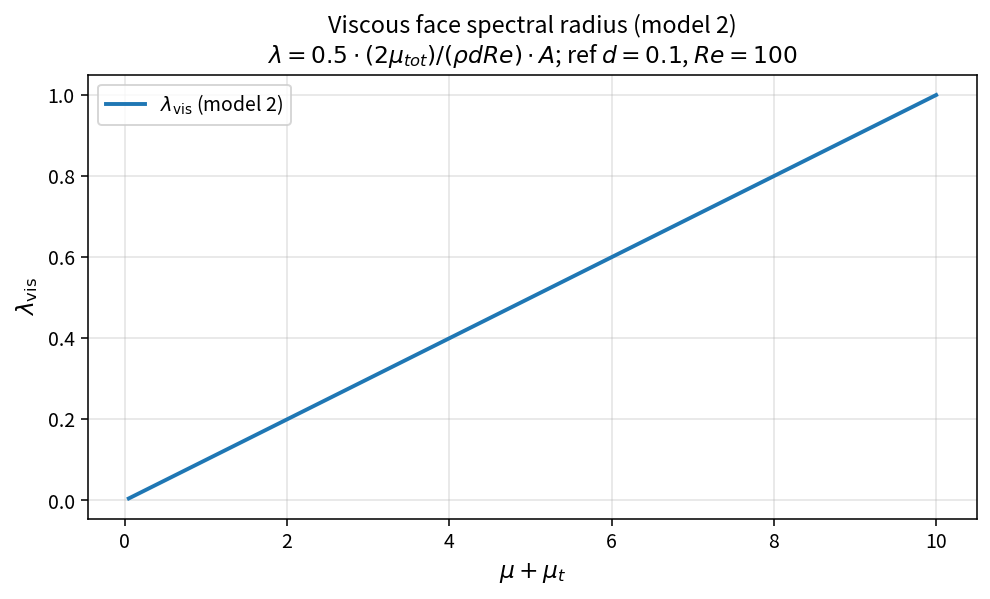

Viscous face spectral radius (model 2)
======================================

Purpose
-------

Model 2 estimates the viscous spectral contribution using an explicit
length scale :math:`d` (cell size or wall distance), rather than the
area-squared form of model 1.

Formula
-------

.. math::

   c_1=\frac{2\mu_{\mathrm{tot}}}{\rho\,d\,\mathrm{Re}},\qquad
   \lambda_{\mathrm{vis}}=\frac{1}{2} c_1 A

Derivation (sketch)
-------------------

Diffusion rate :math:`\nu/d^{2}` with :math:`\nu\sim\mu/(\rho\,\mathrm{Re})`
gives a viscous inverse-time scale. Mapping to a face contribution linear in
:math:`A` yields the form above (engineering coefficients :math:`2` and
:math:`1/2`).

Source map
----------

* ``ViscousFaceSpectralRadiusModel2`` in ``TimeStepPolicy``
* Tests: ``tests/solver/timestep_policy_test.cpp``
* Theory table: ``tools/verification/data/viscous_spectral_radius_model2_theory.csv``
* Contract Workbench id: ``viscous_spectral_radius_model2``

What this proves / does not prove
---------------------------------

**Proves:** model-2 algebra and inverse scaling with :math:`d` match the pure API.

**Does not prove:** how :math:`d` should be chosen on a mesh, or equivalence to model 1.

References
----------

* J. Blazek, *Computational Fluid Dynamics: Principles and Applications*
* OneFLOW ``TimeStepPolicy``
