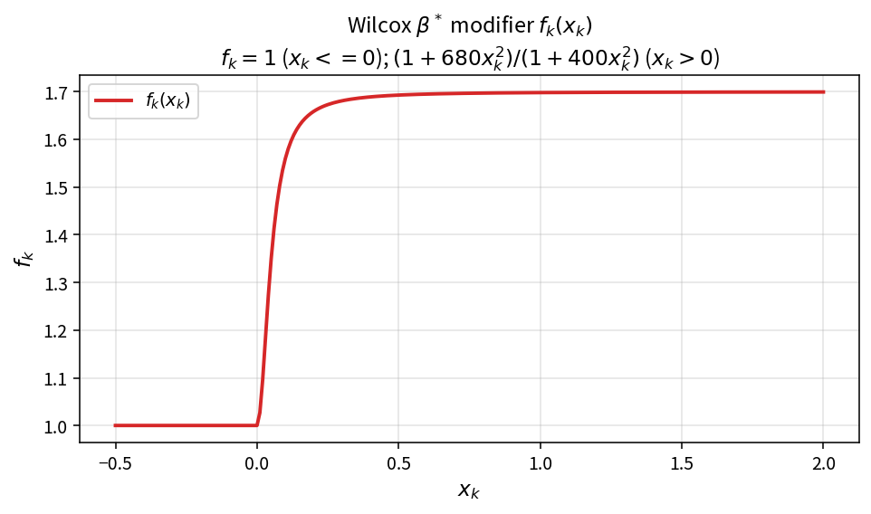
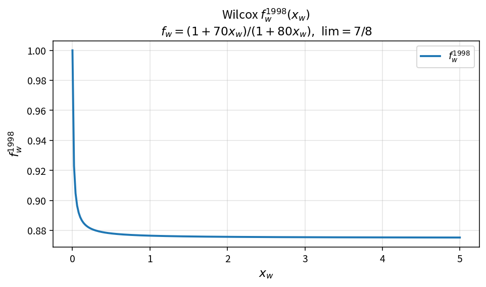
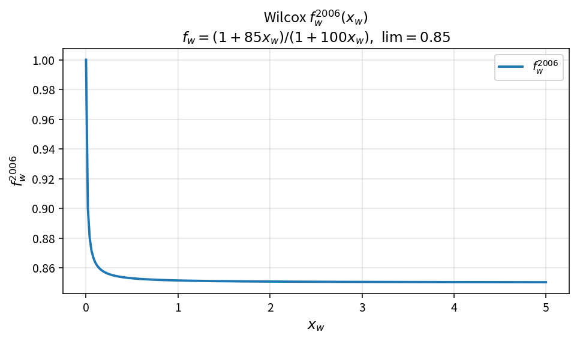

Wilcox f_k and f_w modifiers
===========================

Wilcox k-omega variants scale dissipation coefficients with bounded
functions of cross-diffusion and vortex stretching.

.. math::

   x_k = (\nabla k\cdot\nabla\omega)/\omega^3

.. math::

   f_k =
   \begin{cases}
   1 & x_k \le 0 \\
   (1+680 x_k^2)/(1+400 x_k^2) & x_k > 0
   \end{cases}

.. math::

   f_w^{1998}=(1+70 x_w)/(1+80 x_w),
   \qquad
   f_w^{2006}=(1+85 x_w)/(1+100 x_w)

Intermediate checks: \(f_k(0)=1\), \(f_w\to 7/8\) as \(x_w\to\infty\) (1998).

References
----------

* Wilcox, D. C. Turbulence Modeling for CFD.
* NASA TMR — Wilcox k-omega variants.
* See ``verification_layers.rst`` and ``references.rst``.

Pure APIs: ``WilcoxXkFromCrossTerm``, ``WilcoxFkFromXk``,
``WilcoxFw1998``, ``WilcoxFw2006``, ``WilcoxVortexStretchingInvariant``.

Intermediate verification
-------------------------

Closed-form checks of :math:`f_k(x_k)` live in ``turb_wilcox_fbeta_test``
and ``tools/verification/data/wilcox_fk_xk_theory.csv`` (Contract Workbench).

The beta modifiers :math:`f_w^{1998}=(1+70 x_w)/(1+80 x_w)` and
:math:`f_w^{2006}=(1+85 x_w)/(1+100 x_w)` are locked in
``turb_wilcox_fbeta_test`` with theory tables under
``tools/verification/data/wilcox_fw*_theory.csv``.

