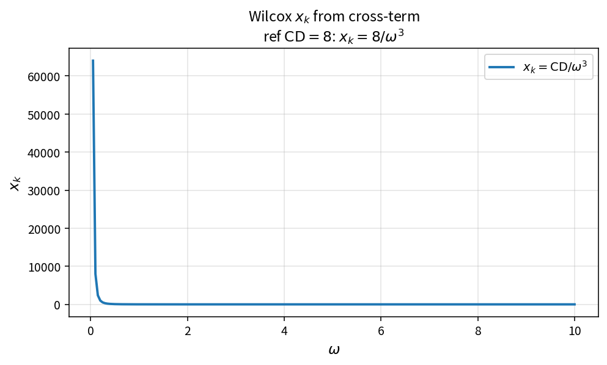

Wilcox xk from cross-term
=========================

Purpose
-------

Form the dimensionless cross-diffusion parameter \(x_k\) used by Wilcox
\(f_{\beta^*}\) / \(f_k\) closures.

Formula
-------

.. math::

   x_k = \frac{\mathrm{CD}}{\omega^{3}}

Source map
----------

* ``WilcoxXkFromCrossTerm`` in ``TurbSstPolicy``
* Downstream: ``WilcoxFkFromXk``
* Tests: ``tests/solver/turb_wilcox_fbeta_test.cpp``
* Theory table: ``tools/verification/data/wilcox_xk_from_cross_term_theory.csv``
* Contract Workbench id: ``wilcox_xk_from_cross_term``

What this proves / does not prove
---------------------------------

**Proves:** \(x_k\) algebra matches the pure API and feeds ``WilcoxFkFromXk``.

**Does not prove:** full Wilcox residual field on a case mesh.

References
----------

* Wilcox \(k\)-\(\omega\) model variants; NASA TMR.
* Related catalog: ``sst_cross_diff_wilcox``.
